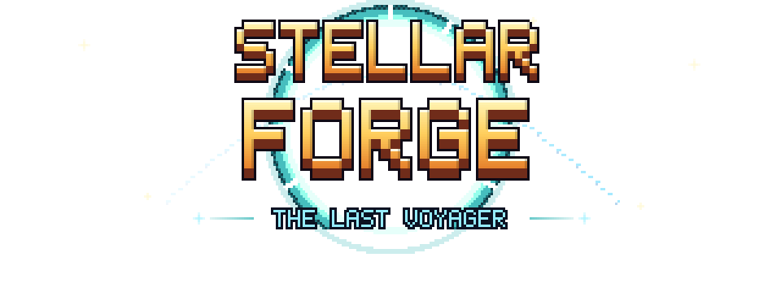

# Stellar Forge: The Last Voyager



An infinite, procedurally generated 2D space adventure in Pygame. Fly a
physics-driven rocket through an endless seeded galaxy, land on any planet and
explore its infinite side-scrolling surface, raid ancient strongholds for the
three Keys, and face the Warlord who destroyed your homeworld.

## Run it

```bash
pip install -r requirements.txt
python -m stellar_forge        # or: python main.py
```

Progress autosaves when you land, launch, dock or collect a Key or Shard.
**Continue** on the title screen picks up where you left off; the save card
next to it shows your chapter, Keys, Shards, rank and play time.

## The story

You wake from cryo-sleep on **Aster** after a crash. A distress signal leads you
to **Haven Station**, which the Warlord's raiders are attacking. Commander Vey
tells you about three **Ancient Keys** (Sun, Frost and Verdant). Together they
command the **Stellar Forge**, the machine that shattered Earth-Prime.

1. **Awakening**: board your rocket.
2. **Distress Signal**: dock at Haven Station.
3. **Defensive Maneuvers**: destroy 5 raiders.
4. **The Three Keys**: follow the gold relic compass to Desert, Frozen and
   Verdant worlds, find each stronghold and solve its door-glyph lock.
5. **Return to Haven**: the Keys resonate, and the Warlord arrives.
6. **The Warlord**: a three-phase boss fight (swarm → orb reflection → sword duel).

**Act II: The Shattered Forge.** The Warlord's death shatters the Forge's core,
shown in a short in-engine cutscene (Enter skips).

7. **The Shattered Forge**: five Forge Shards sit in vaults on Crystalline,
   Volcanic, Toxic, Oceanic and Barren worlds 3 to 5 sectors out (violet compass,
   marked on the map). Each world is blockaded by a **Remnant Warden**, a
   dreadnought boss that fires fans, radial bursts and homing torpedoes and
   launches escorts. Destroy it, land, and crack a six-seal vault.
8. **Worldsmith**: bring the Shards to the Stellar Forge near Haven and press
   [E]. **You choose**: reignite it to rebuild Earth-Prime (a new world you
   can land on appears at Haven), or shatter it forever (the Remnant weaken).
   Each choice has its own ending sequence before the credits.
9. **Legend of the Voyager**: free play, plus a teal signal at the galaxy's rim.
   Follow it to the **Bell**.

**Act III: The Makers.** The Bell knows your name. You and ORA are Maker-built
*seedwalkers*, planted to wake if a Forge ever stirred, and the Smiths of Anvar
are coming to judge what the younger peoples made of their machine.

10. **The Maker Road**: three waystones far out (teal compass and map), each with
    a trial:
    - **Making**: hold the waystone for a minute against raider waves.
    - **Memory**: answer three questions; the answers are in the story.
    - **Mercy**: the crippled Remnant ship *Penitent*. Spare it or destroy it.
11. **The Last Smith**: ring the Bell again and fight the Makers' judge. Who flies
    with you depends on what you did: a Survey Corps wing (bigger with rank), the
    Remnant Free Fleet (if you showed mercy), New Dawn lancers (if you saved the
    ark), and frontier militia (if you helped the settlers). The Makers' verdict
    weighs it all.
12. **Voyager Eternal**: the galaxy is yours.

**Side arcs that feed the finale**
- **The New Dawn**: after the Warlord falls, Vey hears of an ark of 2,000
  survivors hiding in a nebula (her brother is aboard). Find it, then escort it
  home to Haven through raider attacks.
- **Remnant defectors**: battered Remnant ships hail you in Act II. Escort them
  to Haven and the Remnant's standing with you rises.
- **Homecoming**: land on the rebuilt Earth-Prime (or on Aster, if you destroyed
  the Forge and saved the ark) to find a town of everyone you helped.

## Things to do (during and after the story)

**In space**
- **Random encounters** every minute or so:
  - distress beacons (a rescue, or a raider trap; scan first to know);
  - drifting cargo pods (tow one to a station, or crack it open);
  - comet showers to mine;
  - solar flares (hide behind a planet);
  - pirates who want a bribe. Pay, bluff or fight.
- **Derelict ships** to board: dark side-scrolling interiors with security
  drones, crates, crew terminals and a captain's vault at the end.
- **Remnant flagships** roam the deep sectors as space bosses, and stations
  offer Remnant Hunt contracts for them.

**On planets**
- **Planet bosses** on rare worlds:
  - Sand Wyrm (desert)
  - Frost Golem (ice)
  - Magma Titan (volcanic)
  - Hive Queen (crystal)
  - Leviathan (ocean)

  Every attack is signalled before it lands. Each boss drops a trophy with a
  permanent perk and a high-rarity mod.
- **Caves** below many worlds: endless, dark, ore-rich, with glowing geodes
  that hold loot and lore.
- **Day and night**: at night creatures hit harder and ore nodes glow (bonus
  ore).
- **Grappling hook**: swing across chasms, climb cliffs and cave ceilings.
- **Creature scanner**: catalogue every species for the codex.

**Progression**
- **Outposts**: claim any world, then build drills and fuel pumps that work
  while you're away, plus warp beacons that link a fast-travel network.
- **Ships**: the Voyager, plus a fast Scout, a heavy Gunship and a big-cargo
  Hauler.
- **Weapons**:
  - In space: blaster, homing missiles, cutting beam and proximity mines.
  - On foot: sword or Ion Spear, and a charged blaster shot.
- **Mods** in four rarities (common, rare, epic, legendary), with 3
  equipment slots.
- **Factions**: Haven Coalition, Free Traders and the Remnant. Your choices
  change your standing, which changes prices; hostile factions refuse
  service.
- **Trading**: every planet type produces a good. Buy where it's made, sell
  where it isn't.
- **Station rumours**: pay for leads to beasts, wrecks, vaults and caves.
- **30 lore logs** that tell who built the Forge and how Earth-Prime fell.

**Long-term**
- **Logbook** [B] with five tabs: Journal, Codex (planet types, fauna,
  trophies), Archive (lore), 38 Achievements with pilot ranks from Cadet to
  Legend, and Stats with your faction standings.
- **New Game+**: a new galaxy with tougher enemies and a stronger Warlord.
  You keep your gear.
- **Daily Voyage**: the same galaxy for everyone each day, with a local
  best score.

Every seed is guaranteed to be winnable: one stronghold for each Key is placed
within two sectors of home. More strongholds, holding ancient caches, exist
everywhere.

## Controls

| Space flight | |
|---|---|
| W / ↑ | thrust (SHIFT = boost) |
| A D / ← → | rotate |
| S / ↓ | match speed with the nearest body (your brake) |
| SPACE / mouse | fire |
| L / E | land / dock or enter wormhole |
| M / TAB | galaxy map / cycle target |
| V (wheel, + -) | camera distance: close / medium / far (remembered) |
| C | hail the Survey Corps: refuel, repair, rescue tow, escorts, contracts |
| P | autopilot to the TAB target or map waypoint |
| Q | switch weapon |
| M then click | set a waypoint (right-click clears) |

| On foot | |
|---|---|
| A D | walk |
| W | jump; hold it in the air for the jetpack |
| SPACE / J | sword (mines ore, reflects the boss's orbs) |
| F / K | blaster |
| E | board rocket, enter stronghold or cave, mine |
| G | grappling hook (hold W to aim higher, hold G to reel in, jump to let go) |
| C (hold) | scan a creature |
| F (hold) | charged piercing shot |
| O | outpost menu (at your rocket) |
| Q | swap sword and spear |

B opens the Logbook · Enter advances dialogue · Esc pauses · F11 fullscreen · F3 FPS.

| Gamepad | |
|---|---|
| Stick / D-pad | steer, walk, navigate menus |
| A / B / X / Y | fire & confirm / back / dock & interact / land |
| LB / RB, LT / RT | boost / blaster, brake / thrust |
| On foot | A jump, X sword, Y interact, RB blaster |
| Start / View / R-stick | pause / map / logbook |
| Guide / L-stick click | camera distance / hail the Corps |

Controllers are detected on the fly. A always advances dialogue.

**Settings** (title screen or pause menu) covers:
- master, music and SFX volume;
- screen shake, fullscreen, control hints and the FPS counter;
- **colour-blind signals** (an Okabe-Ito palette for enemies, compass arrows
  and warnings);
- **rebinding of every action**.

Settings are saved to `saves/settings.json`.

There are **three save slots** (plus a separate daily slot) and three
difficulties: Story, Voyager and Hardened. The ship AI gives one-time hints
the first time you meet each new thing; these can be switched off.

## What's in the galaxy

- **Infinite sectors** (40k px each), generated on demand from the world seed
  and rebuilt identically when you return. Only your changes are saved.
- **Star systems** with M–B class stars, 3–7 planets on analytic orbits, moons,
  asteroid belts and space stations.
- **Deep space**: black holes (deadly gravity wells), pulsars (sweeping
  radiation beams), nebulae (hide from raiders) and wormholes (jump 4–12
  sectors).
- **9 biomes**: Desert, Frozen, Verdant, Oceanic, Volcanic, Toxic,
  Crystalline, Barren and Gas Giant. Biomes are picked from star brightness,
  orbital distance and planet size. Each has its own gravity, friction, liquids
  (water, lava, acid), weather, props, fauna and ore.
- **ML planet model**: a scikit-learn polynomial regression predicts planet
  size and density from orbital distance. Each planet is then sampled around
  that prediction with its own seeded random generator.
- **Danger scales with distance** from home, which affects raider count,
  elites, creature health and cache rewards.
- **Economy**: mine ore, sell scan data, take contracts (bounty, survey,
  cartography, mining) and buy 7 upgrade tracks at stations.

## Art and sound

The original hand-drawn sprites are in `assets/`. The extra art (the logo,
title backdrop, props for five biomes, five stronghold entrances, creatures,
Forge Shards, the Remnant dreadnought, the Forge gate, character portraits and
UI icons) is drawn in code by `tools/generate_assets.py` in the same style:
flat fills, one highlight, one shadow and a dark outline. The output in
`assets/generated/` is committed. To rebuild it:

```bash
python tools/generate_assets.py
```

There are no audio files. Sound effects and the six music tracks (title,
space, surface, stronghold, boss, ending) are synthesised with numpy at
startup and cross-faded as you move between scenes.

## Project structure

```
stellar_forge/
  config.py              all tunables
  core/      game.py (loop + services), scene.py (scene stack + fades), input.py (gamepad),
             game_state.py (save data + derived stats), settings.py, assets.py,
             audio.py (synthesised SFX), music.py (procedural soundtrack),
             camera.py, events.py (pub/sub bus)
  world/     universe.py (sector cache), sector.py (system generation),
             biomes.py (data-driven biome registry), planet_model.py (ML),
             planet_art.py (numpy-rendered planets), noise.py, rng.py, names.py
  entities/  bodies.py (stars, planets, stations, hazards), ship.py,
             enemies.py, projectiles.py
  surface/   terrain.py (infinite chunked terrain), player.py (grapple, spear),
             bosses.py (five planet bosses), creatures.py, props.py, weather.py
  systems/   quests.py (story + contracts), achievements.py, space_events.py,
             items.py (ships, weapons, mods, goods, factions), lore.py,
             rumours.py, daily.py, gravity.py, particles.py
  scenes/    menus (title, slots, settings, keybinds, credits, pause), space,
             surface, cave, derelict, outpost, station, choice, map, logbook,
             stronghold, boss, cutscene, act_two (+ the Bell), ending
  ui/        hud.py, overlay.py (dialogue/toasts/banners), lighting.py (night,
             caves, wrecks), floaters.py (damage numbers), palette.py
             (colour-blind mode), starfield.py, text.py
tests/       determinism, winnability, Act II flow, menus, save round-trip
tools/       generate_assets.py + art_more.py (procedural art in the house
             style), build.py (PyInstaller)
```

Run the tests with `python -m pytest tests`. They also run on GitHub Actions
(`.github/workflows/tests.yml`).

## Building an executable

```bash
pip install pyinstaller
python tools/build.py              # -> dist/StellarForge (or .exe on Windows)
python tools/build.py --no-ml      # smaller: skips scikit-learn (numpy fallback)
```

A packaged build keeps its saves in `%APPDATA%/StellarForge` (Windows) or
`~/.local/share/StellarForge` (Linux and macOS).

## License

MIT
